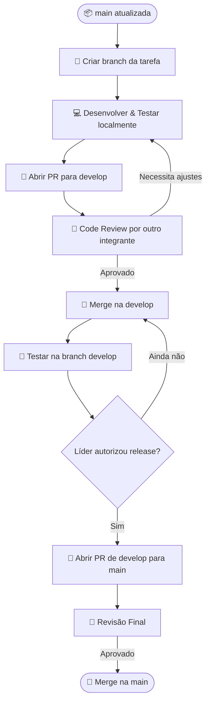

# 📰 New News — Documentação do Projeto

> **Feed de notícias auto-atualizado, moderno e personalizado.**

**Equipe:** Vinícius • Júnior • Jair • Thais • João  
**Status do Projeto:** Em Desenvolvimento  

---

## 📑 Sumário

- [💡 1. Visão Geral](#-1-visão-geral)
- [📌 2. Requisitos Funcionais](#-2-requisitos-funcionais)
- [⚙️ 3. Requisitos Não Funcionais](#-3-requisitos-não-funcionais)
- [💻 4. Diretrizes de Desenvolvimento](#-4-diretrizes-de-desenvolvimento)
  - [4.1 Padrão de Branches](#41-padrão-de-branches)
  - [4.2 Convenção de Commits](#42-convenção-de-commits)
  - [4.3 Padrões de Código](#43-padrões-de-código)
  - [4.4 Fluxo de Trabalho (Git Workflow)](#44-fluxo-de-trabalho-git-workflow)
  - [4.5 Políticas de Pull Request (PR)](#45-políticas-de-pull-request-pr)
  - [4.6 Testes e Homologação](#46-testes-e-homologação)
  - [4.7 Boas Práticas e Organização](#47-boas-práticas-e-organização)

---

## 💡 1. Visão Geral

O **New News** é uma plataforma de notícias auto-atualizada onde os usuários podem criar contas, selecionar categorias de interesse e acompanhar as novidades em tempo real sobre futebol, esportes, tecnologia, games, política, economia, entretenimento e mundo.

As notícias são integradas e atualizadas periodicamente via API externa, contando com persistência em banco de dados, autenticação de usuários, personalização de feed e infraestrutura orquestrada via Docker.

---

## 📌 2. Requisitos Funcionais

| ID | Funcionalidade | Descrição |
| :---: | :--- | :--- |
| **RF01** | **Cadastro de Usuário** | Permitir o registro de novos usuários informando nome, e-mail e senha. |
| **RF02** | **Autenticação (Login)** | Permitir acesso seguro à plataforma utilizando e-mail e senha cadastrados. |
| **RF03** | **Visualização de Notícias** | Exibir os artigos contendo título, imagem de destaque, resumo, data de publicação e categoria. |
| **RF04** | **Categorização** | Disponibilizar seções temáticas: `Futebol`, `Esportes`, `Tecnologia`, `Games`, `Comida`, `Entretenimento`, `Música`, `Política`, `Economia`, `Brasil` e `Mundo`. |
| **RF05** | **Filtro por Categorias** | Possibilitar a filtragem do feed por tópicos específicos de interesse. |
| **RF06** | **Pesquisa de Notícias** | Permitir busca textual dinâmica de notícias a partir de palavras-chave. |
| **RF07** | **Atualização Automática** | Ingestão periódica de novas notícias de forma automatizada via API externa. |
| **RF08** | **Leitura Completa** | Permitir que o usuário abra e acesse a página ou fonte completa do conteúdo da notícia. |
| **RF09** | **Favoritos** | Permitir que usuários autenticados salvem notícias e acessem uma lista exclusiva de favoritos. |
| **RF10** | **Monitoramento e Personalização** | Registrar interações com as notícias para viabilizar futuras recomendações personalizadas. |
| **RF11** | **Gestão de Perfil** | Permitir ao usuário autenticado visualizar e gerenciar seus dados cadastrais e preferências. |

---

## ⚙️ 3. Requisitos Não Funcionais

| ID | Categoria | Descrição |
| :---: | :--- | :--- |
| **RNF01** | **Desempenho** | Notícias, listagens, filtros e buscas textuais devem responder rapidamente com baixo tempo de latência, sem travamentos de interface. |
| **RNF02** | **Segurança** | Dados cadastrais protegidos; senhas obrigatoriamente armazenadas com algoritmos de hash criptográfico seguro. Usuários só têm acesso aos seus próprios dados e favoritos. |
| **RNF03** | **Usabilidade** | Interface intuitiva, limpa e de fácil navegação. Categorias visíveis e organização clara de título, imagem, resumo e data. |
| **RNF04** | **Responsividade** | Layout adaptável para múltiplos tamanhos de tela (desktop, tablets e smartphones). |
| **RNF05** | **Confiabilidade & Resiliência** | Mecanismo de deduplicação para evitar notícias repetidas no feed. Tratamento amigável e informativo caso a API externa fique indisponível. |
| **RNF06** | **Disponibilidade & Atualização** | Rotina de atualização constante em background mantendo os dados categorizados e prontos para consumo. |

---

## 💻 4. Diretrizes de Desenvolvimento

Para garantir a qualidade, padronização e manutenibilidade do código do projeto, todo o time deve seguir as regras abaixo:

### 4.1 Padrão de Branches

- Todas as branches devem ser nomeadas em **inglês**.
- Toda nova branch deve ser criada a partir da branch `main` atualizada (ou `develop`, conforme estratégia combinada da sprint).
- O nome deve ser representativo e em formato kebab-case (`tipo/nome-da-tarefa`).

**Exemplos:**
- `feat/login`
- `feat/register`
- `feat/favorites`
- `feat/user-profile`
- `fix/news-card-overflow`

---

### 4.2 Convenção de Commits

Adotamos a especificação do **Conventional Commits**. Todas as mensagens devem ser concisas e redigidas em **inglês**:

| Tipo | Finalidade | Exemplo |
| :--- | :--- | :--- |
| `feat` | Nova funcionalidade para o usuário | `feat: add login page` |
| `fix` | Correção de bug | `fix: correct user validation` |
| `style` | Alterações de formatação, CSS ou espaçamento | `style: update header layout` |
| `refactor` | Refatoração de código sem alterar regra de negócio | `refactor: organize user service` |
| `docs` | Alterações e melhorias em documentação | `docs: update project documentation` |
| `test` | Criação ou ajuste de testes | `test: add unit tests for auth service` |
| `chore` | Tarefas auxiliares de build, dependências ou configs | `chore: update docker compose dependencies` |

---

### 4.3 Padrões de Código

- Todos os identificadores e nomes no código-fonte devem ser escritos em **inglês**:
  - Arquivos e pastas
  - Classes, IDs e componentes
  - Variáveis, funções e métodos
  - Props, interfaces e estados
- **Exemplos:**
  - Classes/IDs CSS: `.login-form`, `#user-profile`
  - Componentes React: `<NewsCard />`, `<UserProfile />`
  - Funções/Métodos: `getUserData()`, `fetchLatestNews()`

---

### 4.4 Fluxo de Trabalho (Git Workflow)

---

### 4.5 Políticas de Pull Request (PR)

> [!IMPORTANT]
> **Nenhum integrante pode aprovar ou realizar o merge do próprio PR sozinho.**

1. Todo PR de funcionalidade ou correção deve ser direcionado primeiramente para a branch `develop`.
2. O PR deve conter título claro e descrição sucinta do que foi implementado ou corrigido.
3. Todo PR exige revisão e aprovação de pelo menos **um outro integrante** do time antes de ser mesclado.
4. Somente após a validação e homologação na `develop` — e com aval do líder — é realizado o PR de promoção para a `main`.

---

### 4.6 Testes e Homologação

- **Pré-PR:** Cada desenvolvedor deve testar localmente toda a funcionalidade e fluxos correlatos antes de abrir o Pull Request.
- **Pós-Merge em develop:** A branch `develop` deve ser testada integralmente para garantir que integrações recentes não quebraram funcionalidades existentes.
- **Critério para main:** Qualquer bug ou regressão identificado na `develop` deve ser sanado antes do merge para a `main`. A `main` é o ambiente estável de entrega.

---

### 4.7 Boas Práticas e Organização

- 🗂️ **Organização:** Mantenha pastas e arquivos estruturados dentro de suas respectivas camadas (frontend/backend).
- 🧹 **Código Limpo:** Remova `console.log`, `print` ou debuggers usados apenas durante o desenvolvimento.
- 🚫 **Código Morto:** Não suba código comentado sem justificativa clara.
- 📦 **Commits Limpos:** Não envie arquivos temporários, caches, `.env` com segredos ou dependências locais.
- 🧩 **Reutilização:** Priorize componentes modulares, legíveis e reutilizáveis.
- ⚔️ **Conflitos:** Resolva quaisquer conflitos de merge na sua branch antes de solicitar a aprovação do PR.
